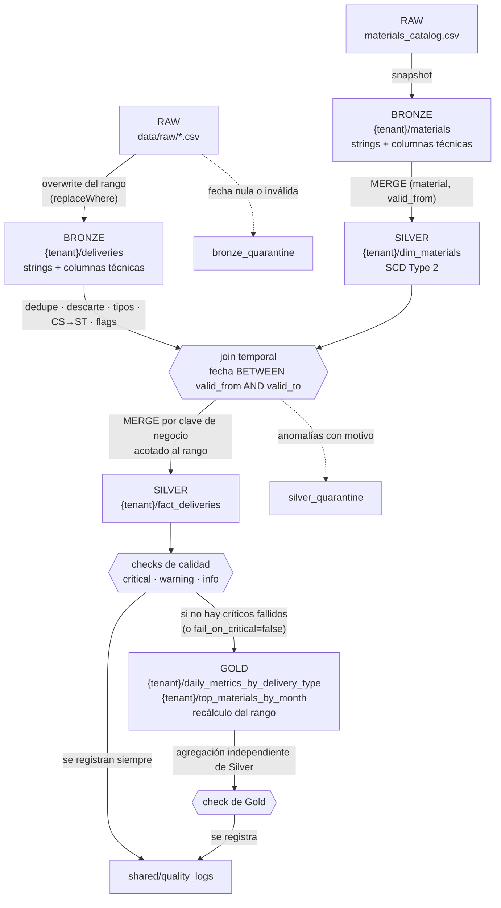

# saas-data-platform

Pipeline Medallion multi-tenant (RAW → Bronze → Silver → Gold) sobre **PySpark + Delta Lake**,
implementado sobre la arquitectura provista del proyecto SAAS: configuración jerárquica por
ambiente y tenant, SCD Type 2 con join temporal, cuarentena de anomalías, checks de calidad
persistidos e idempotencia en todas las capas.

| Documento | Contenido |
|---|---|
| [docs/observations.md](docs/observations.md) | Ambigüedades resueltas, desacuerdos con la arquitectura y mejoras propuestas |
| [docs/infra.md](docs/infra.md) | Qué provisionaría Terraform por tenant, con snippet del módulo |
| [docs/onboarding-tenant.md](docs/onboarding-tenant.md) | Alta de un tenant nuevo paso a paso |
| [mentoring/code_review.md](mentoring/code_review.md) | Revisión de `bad_code.py`, refactor y nota al junior |
| [notebooks/demo.ipynb](notebooks/demo.ipynb) | Notebook de demo con los resultados del pipeline |

## Resultado sobre el dataset de la prueba

Corrida completa de los 6 tenants (`make run`), semestre 2025-01-01 a 2025-06-30:

| Etapa | Filas | Detalle |
|---|---|---|
| CSV de entrada | 3 115 | 6 tenants: SV, HN, EC, JM, GT, PE |
| Bronze: `deliveries` | 3 075 | Las 40 restantes van a `bronze_quarantine` (fecha nula o inválida) |
| Bronze: `materials` | 35 por tenant | Snapshot del catálogo; Silver construye `dim_materials` desde aquí |
| Silver: duplicados exactos | 15 | Se conserva una copia |
| Silver: descartadas | 188 | `tipo_entrega` COBR o Z99: se cuentan, no se guardan |
| Silver: cuarentena | 75 | Cantidad ≤ 0 o nula, material fuera de catálogo |
| Silver: `fact_deliveries` | 2 797 | 15 + 188 + 75 + 2 797 = 3 075: ninguna fila se pierde |
| Gold: `daily_metrics_by_delivery_type` | 688 | Una fila por tenant, día y tipo de entrega |
| Gold: `top_materials_by_month` | 180 | Top 5 materiales por revenue, por tenant y mes (6 × 6 × 5) |

Todos los checks críticos pasan. Dos ejecuciones seguidas dejan exactamente los mismos conteos.

## Requisitos y versiones

| Componente | Versión |
|---|---|
| Python | 3.11 (3.11.10) |
| PySpark | 3.5.3 |
| delta-spark | 3.2.1 |
| OmegaConf | 2.3.0 |
| Java (requerido por Spark) | OpenJDK 17 |
| uv (gestor de entorno) | 0.5.4 |
| ruff / pytest | 0.7.4 / 8.3.3 |

Las versiones son compatibles con Databricks Runtime 15.x LTS (Spark 3.5, Delta 3). Todo el árbol
de dependencias está fijado en `uv.lock`. El entorno local y el CI usan Python 3.11
(`.python-version`) porque PySpark 3.5 no soporta oficialmente 3.12; el paquete en sí acepta
Python ≥ 3.11. PySpark y delta-spark no son dependencias del paquete sino del grupo `spark`,
que `uv` instala por defecto: en Databricks los aporta el runtime (ver "Ejecutar en Databricks").

## Puesta en marcha

Linux, o Windows con **WSL2 (Ubuntu 24.04)**:

```bash
sudo apt install -y openjdk-17-jdk make
curl -LsSf https://astral.sh/uv/0.5.4/install.sh | sh
git clone https://github.com/OvaR82/saas-data-platform.git
cd saas-data-platform
make setup          # crea el entorno con las versiones de uv.lock e instala los hooks de git
```

La primera ejecución de Spark descarga los jars de Delta desde Maven (requiere internet una vez).

### Recomendado en WSL2

Si el código vive en el disco de Windows (`/mnt/<unidad>/...`), conviene que el entorno virtual y
los datos generados queden en el disco de Linux: Delta hace muchas escrituras pequeñas y
`/mnt/<unidad>` es bastante más lento (medido: ~114 s frente a ~56 s por tenant). En `~/.bashrc`:

```bash
export UV_PROJECT_ENVIRONMENT=$HOME/.venvs/saas-data-platform
export SAAS_DATA_ROOT=$HOME/saas-data
```

## Ejecutar el pipeline

```bash
make run                                        # todos los tenants, todas las capas, semestre completo
make run TENANT=sv START=2025-03-01 END=2025-03-31
make run ENV=qa TENANT=hn LAYERS=bronze,silver
```

El Makefile llama a la CLI, que también se puede usar directamente:

```bash
uv run saas-pipeline run --env dev --tenant sv --start-date 2025-03-01 --end-date 2025-03-31
uv run saas-pipeline run --tenant all execution.fail_fast=true quality.fail_on_critical=true
uv run saas-pipeline validate-config
```

| Argumento | Descripción |
|---|---|
| `--env` | `dev`, `qa` o `main` |
| `--tenant` | Código en minúscula (`sv`) o `all`. Por defecto, `execution.tenant` |
| `--start-date`, `--end-date` | Rango de `fecha_proceso` a procesar (`YYYY-MM-DD`) |
| `--layers` | Subconjunto de `bronze,silver,gold` |
| `clave=valor` | Cualquier parámetro de configuración, con la máxima precedencia |

Con `--tenant all`, si un tenant falla los demás continúan (salvo `execution.fail_fast=true`); al
final se listan los fallidos y el proceso termina con código distinto de cero.

## Pruebas y linter

```bash
make lint             # ruff check + ruff format --check (PEP8, imports, bugs comunes)
make test             # pytest: 45 pruebas, con Spark real (en modo ANSI)
make validate-config  # carga todas las combinaciones de ambiente y tenant
make format           # corrige el formato automáticamente
make infra-validate   # terraform fmt + validate del snippet de docs/infra.md (requiere Terraform)
```

Las pruebas cubren:

- **Configuración**: precedencia, rutas por ambiente, fechas estrictas `YYYY-MM-DD` y errores de
  configuración sin traceback.
- **Bronze**: validación de fechas, columnas técnicas, idempotencia, reproceso de un rango y el
  snapshot del catálogo.
- **Silver**: casts seguros con valores basura, conversión de unidades, flags, join temporal
  SCD2 y cuarentena con todos sus motivos (incluido "SKU sin versión vigente").
- **Gold**: métricas diarias, ranking mensual y su recálculo por mes completo.
- **Calidad**: invariantes SCD2 (solapamientos, huecos, una versión vigente), conciliación, check
  de Gold contra Silver, esquema de `quality_logs` y la puerta `fail_on_critical`.
- **De punta a punta**: corrida completa repetida (idempotencia), por ruta y por nombre de tabla
  (`storage.mode=catalog`).
- **Mentoría**: el refactor de `good_code.py`.

Toda la suite corre con el modo ANSI de Spark activado (el más estricto, por defecto en
Databricks serverless). En GitHub Actions corre en cada pull request y en cada push a `main`,
junto con el linter, la validación de los YAML y el armado del wheel
([.github/workflows/ci.yml](.github/workflows/ci.yml)).

## Notebook de demo

```bash
make notebook
```

Abre Jupyter (en el mismo entorno del proyecto) en `notebooks/`; la URL que imprime se abre en el
navegador. `demo.ipynb` ejecuta el pipeline para un tenant y muestra los checks de calidad, Gold, la
cuarentena por motivo, la evidencia del join temporal, el historial de Delta (idempotencia), el
reproceso de un mes y vistas SQL para consultas libres.

## Ejecutar en Databricks

La prueba se demuestra en local, pero el código está preparado para Databricks sin cambios:

| Qué | Cómo se resolvió |
|---|---|
| Sesión de Spark | `get_spark()` reutiliza la sesión activa del cluster; no crea una local ni descarga jars |
| PySpark y Delta | No son dependencias del paquete (los aporta el runtime); instalarlo no pisa el Spark del cluster |
| Modo ANSI (activado por defecto en serverless) | Fechas, casts y divisiones usan `try_to_timestamp`, `try_cast` y `try_divide`; los tests corren con ANSI activado |
| Rutas | Ninguna fija en el código: configuración (`config_dir`) y datos (`paths.*`) se pasan por parámetro |
| Tablas por nombre de Unity Catalog | `storage.mode=catalog`: las mismas capas leen y escriben `saas_<env>.<layer>_<tenant>.<tabla>` en lugar de rutas (probado en local contra el catálogo de Spark) |

**Ejemplo en un notebook**, con el repo clonado como *Git folder* del workspace:

```python
%pip install /Workspace/Users/<usuario>/saas-data-platform
```
```python
from pathlib import Path
from saas_pipeline.pipeline import LAYER_ORDER, run

REPO = Path("/Workspace/Users/<usuario>/saas-data-platform")
run(
    env="qa",
    tenant_selection="all",
    layers=list(LAYER_ORDER),
    overrides=[
        "paths.raw=/Volumes/<catalogo>/<schema>/<volumen>/raw",  # CSV de entrada
        "storage.mode=catalog",  # tablas saas_qa.<layer>_<tenant>.<tabla>
    ],
    config_dir=REPO / "config",
)
```

Como **job**, el paquete se instala como wheel (`uv build`) y se ejecuta la entrada
`saas-pipeline` con los mismos argumentos que en local, más `SAAS_CONFIG_DIR` apuntando a los YAML.

Limitaciones a tener en cuenta:

- **No se ejecutó en un workspace real**: la compatibilidad está diseñada y probada en local (con
  ANSI activado), no validada en Databricks.
- **Ruta o nombre de tabla**: por defecto (`storage.mode=path`) las tablas se leen y escriben por
  ruta, como pide la sección 5.2; en Databricks eso requiere una *external location* con
  permisos sobre la ruta de ADLS. Con `storage.mode=catalog` se usan los nombres de Unity Catalog
  de la arquitectura, que es lo recomendado en workspaces solo con Unity Catalog (como la Free
  Edition). El catálogo (`saas_<env>`) y sus schemas los crea Terraform (`docs/infra.md`); si no
  existen, el pipeline intenta crearlos (`CREATE SCHEMA IF NOT EXISTS`), lo que requiere
  permisos. Ver `observations.md` A15.
- **El modo `catalog` en local**: funciona contra el catálogo propio de Spark (`spark_catalog`),
  pero ese catálogo vive en memoria y se pierde al terminar el proceso, mientras las tablas
  quedan en disco. Por eso desde la CLI corre bien una vez por carpeta y la segunda corrida
  falla (`DELTA_CREATE_TABLE_WITH_NON_EMPTY_LOCATION`). En Databricks no ocurre (Unity Catalog es
  persistente). Para verificarlo en local: `uv run pytest tests/test_catalog_mode.py`, que corre
  el pipeline dos veces dentro de la misma sesión.
- **Configuraciones de Spark en serverless**: `get_spark()` fija la zona horaria (UTC) y la
  política de parseo de fechas. Serverless solo permite cambiar algunas configuraciones; conviene
  confirmar que esas dos están permitidas en el workspace de destino.

## Arquitectura implementada



| Capa | Tabla | Escritura | Partición |
|---|---|---|---|
| Bronze | `deliveries` | Overwrite del rango de fechas (`replaceWhere`) | `fecha_proceso` |
| Bronze | `materials` | Overwrite completo (el catálogo llega como snapshot) | — |
| Silver | `fact_deliveries` | `MERGE` por `(tenant_id, fecha_proceso, transporte, ruta, material, tipo_entrega)` | `fecha_proceso` |
| Silver | `dim_materials` | `MERGE` SCD2 por `(material, valid_from)`; la historia nunca se borra | — |
| Gold | `daily_metrics_by_delivery_type` | Recálculo del rango (`replaceWhere`) | — (ver D1) |
| Gold | `top_materials_by_month` | Recálculo de los **meses completos** que toca el rango (`replaceWhere` por mes) | — |
| Compartida | `quality_logs` | Append (una fila por check y corrida) | — |

### Segunda tabla Gold: `top_materials_by_month` (bonus)

Ranking de los materiales con más revenue por tenant y mes; se guardan los `gold.top_materials_n`
primeros (5 por defecto, configurable por tenant).

| Columna | Descripción |
|---|---|
| `tenant_id`, `month_start` | Tenant y primer día del mes |
| `material`, `descripcion`, `categoria` | Material y la **última versión usada en el mes** (SCD2: puede cambiar a mitad de mes) |
| `total_revenue`, `total_units` | Revenue (precio de la transacción) y unidades ST del mes |
| `revenue_share` | Participación del material en el revenue total del mes del tenant |
| `revenue_rank` | Posición (1 = mayor revenue); empates resueltos por código de material |

Un ranking mensual calculado con parte de un mes sería incorrecto, así que el rango procesado se
**amplía a meses completos**: reprocesar del 10 al 20 de marzo recalcula todo marzo (cubierto por
`test_partial_range_recomputes_the_whole_month`).

Puntos clave:

- **Aislamiento multi-tenant** por ruta (`<layer>/<tenant>/<table>`) o, con
  `storage.mode=catalog`, por schema de Unity Catalog (`saas_<env>.<layer>_<tenant>.<table>`):
  las capas reciben una referencia de tabla y no saben cuál de los dos usan.
- **Cada capa lee solo la anterior**: también el catálogo de materiales pasa por Bronze antes de
  llegar a `dim_materials`.
- **Join temporal**: cada entrega toma la versión del material vigente en su `fecha_proceso`, no la
  actual. Un material sin versión vigente va a cuarentena, no se pierde en el join.
- **Cuarentena con todos los motivos** de una fila (`non_positive_cantidad;material_not_in_catalog`).
- **Reproceso exacto**: el MERGE de Silver borra las filas del rango que ya no vienen en el origen
  (por ejemplo, porque pasaron a cuarentena).
- **Montos con `decimal(38,18)`**, nunca `float`.

El detalle de cada decisión y sus alternativas está en [docs/observations.md](docs/observations.md).

## Configuración

Jerarquía con OmegaConf; cada nivel sobrescribe al anterior:

```
config/base.yaml              defaults compartidos
config/env/<env>.yaml         dev | qa | main (cambian las rutas; main activa fail_on_critical)
config/tenants/<tenant>.yaml  un archivo por tenant
CLI                           --start-date, --end-date y overrides clave=valor
```

| Parámetro | Default | Descripción |
|---|---|---|
| `paths.data_root` | `${oc.env:SAAS_DATA_ROOT,data}` | Base de las capas generadas |
| `paths.bronze`, `silver`, `gold` | `<root>/<layer>` | Rutas base por capa |
| `paths.quarantine_root` | `<root>` | Base de `<layer>_quarantine/<tenant>/<table>` |
| `paths.quality_logs` | `<root>/shared/quality_logs` | Tabla Delta de logs de calidad |
| `execution.start_date`, `end_date` | `2025-01-01`, `2025-06-30` | Rango de `fecha_proceso` |
| `execution.tenant` | `all` | Tenant por defecto de la CLI |
| `execution.fail_fast` | `false` | Abortar `--tenant all` ante el primer fallo |
| `quality.fail_on_critical` | `false` (`true` en `main`) | Detener el tenant antes de Gold si falla un check crítico |
| `quality.max_quarantine_rate` | `0.05` | Umbral del warning de tasa de cuarentena |
| `storage.mode` | `path` | `path`: tablas por ruta (layout de 5.2); `catalog`: nombres de Unity Catalog |
| `storage.catalog` | `saas_${env}` | Catálogo usado en modo `catalog` |
| `gold.top_materials_n` | `5` | Materiales por tenant y mes en `top_materials_by_month` |
| `business.units_per_case` | `20` | Factor CS → ST |
| `business.routine_delivery_types` / `bonus_delivery_types` | `[ZPRE, ZVE1]` / `[Z04, Z05]` | Tipos válidos; el resto se descarta |

`dev` escribe en `<data_root>/...` (la estructura de la arquitectura); `qa` y `main` en
`<data_root>/qa/...` y `<data_root>/main/...`.

### Dónde se escriben los datos

| Ruta | Contenido |
|---|---|
| `data/raw/` | Entradas (CSV). Versionadas y de solo lectura |
| `<data_root>/<layer>/<tenant>/<table>/` | Bronze, Silver y Gold |
| `<data_root>/<layer>_quarantine/<tenant>/<table>/` | Cuarentena de Bronze y Silver |
| `<data_root>/shared/quality_logs/` | Logs de calidad de todos los tenants |

`data_root` vale `./data` por defecto y se mueve con `SAAS_DATA_ROOT`, sin tocar código ni YAML.
`make clean` borra solo las capas generadas, nunca `data/raw`.

## Calidad de datos

| Check | Capa | Severidad | Qué valida |
|---|---|---|---|
| `valid_fecha_proceso` | Bronze | warning | Filas enviadas a cuarentena por fecha nula o inválida |
| `unique_business_key` | Silver | critical | La clave del MERGE es única |
| `material_version_enriched` | Silver | critical | Toda fila encontró su versión de material en el join temporal |
| `single_current_version` | Silver | critical | SCD2: exactamente una versión vigente por material |
| `no_overlapping_versions` | Silver | critical | SCD2: las versiones de un material no se solapan |
| `no_version_gaps` | Silver | warning | SCD2: no hay fechas sin versión vigente entre dos versiones de un material |
| `row_reconciliation` | Silver | critical | Leídas = duplicados + descartadas + cuarentena + escritas |
| `quarantine_rate` | Silver | warning | La cuarentena no supera `max_quarantine_rate` |
| `discarded_delivery_types` | Silver | info | Cuántas filas se descartaron por tipo de entrega |
| `gold_reconciles_with_silver` | Gold | critical | Cada día y tipo de entrega de Gold suma las mismas unidades e ingreso que Silver (agregación independiente) |

Los checks de Bronze y Silver se ejecutan **antes** de Gold y, con `fail_on_critical`, impiden
publicarlo. El de Gold se ejecuta **después** de escribirlo: detecta una agregación incorrecta y
marca el tenant como fallido, pero no puede impedir la publicación.

Cada corrida agrega sus resultados a `quality_logs` con el esquema de la sección 5.9 (`_run_id`,
`_batch_id`, `tenant_id`, `layer`, `table_name`, `check_name`, `check_severity`,
`records_checked`, `records_failed`, `check_passed`, `executed_at`).

## Onboarding de un tenant nuevo

1. Crear `config/tenants/<code>.yaml` con `code`, `name` y `enabled: true` (más los overrides que
   necesite).
2. `make validate-config`.
3. `make run TENANT=<code>`; desde ese momento también entra en `--tenant all`.

En producción, el mismo YAML alimenta al módulo de Terraform que crea sus schemas, carpetas, grants
y secret scope. Detalle en [docs/onboarding-tenant.md](docs/onboarding-tenant.md) y
[docs/infra.md](docs/infra.md).

## Estructura del repositorio

```
saas-data-platform/
├── .github/workflows/ci.yml    CI: ruff, validación de YAML, pytest y armado del wheel
├── config/                     configuración jerárquica (base, env, tenants)
├── data/raw/                   CSV de entrada (el resto de data/ se genera y no se versiona)
├── docs/
│   ├── observations.md         decisiones sobre la arquitectura (obligatorio)
│   ├── infra.md                Terraform: qué se provisiona por tenant + snippet
│   └── onboarding-tenant.md    alta de un tenant paso a paso
├── mentoring/
│   ├── bad_code.py             código del Anexo A, sin modificar
│   ├── good_code.py            refactor
│   └── code_review.md          revisión y nota al junior
├── notebooks/demo.ipynb        notebook de la demo
├── scripts/                    validación del snippet de Terraform (make infra-validate)
├── src/saas_pipeline/
│   ├── cli.py                  entrada de línea de comandos
│   ├── config.py               carga y validación; ubicación de cada tabla (ruta o nombre UC)
│   ├── pipeline.py             orquestación por tenant y fail_fast
│   ├── session.py              SparkSession local o la activa de Databricks
│   ├── storage.py              lectura y escritura Delta por ruta o por nombre (replaceWhere, MERGE)
│   ├── bronze.py · silver.py · gold.py
│   └── quality.py              checks, quality_logs y puerta de calidad
├── tests/                      pytest
├── Makefile                    setup, lint, test, run, notebook, infra-validate, clean
├── pyproject.toml · uv.lock    dependencias fijadas
└── .pre-commit-config.yaml     ruff antes de cada commit
```

Cada capa separa las transformaciones puras (`DataFrame -> DataFrame`, probadas con datos en
memoria) de la función `run()`, la única que lee y escribe.

## Qué dejé fuera y por qué

Primero se completó y probó todo el alcance obligatorio; los bonus se evaluaron después, por costo
y por valor para la entrega.

### Bonus incluidos

| Bonus | Por qué se incluyó | Dónde |
|---|---|---|
| Segunda tabla Gold | Reutiliza Silver tal cual y muestra criterio (recálculo por mes completo, SCD2 dentro del mes) con poco código | `top_materials_by_month`, ver "Segunda tabla Gold" |
| Pre-commit hooks | Costo casi nulo; evita commits que el CI rechazaría y versionar salidas del notebook | `.pre-commit-config.yaml` |
| Terraform funcional (**parcial**) | Hecho: `terraform fmt` y `terraform validate` pasan contra los providers reales (azurerm 4.x, databricks 1.x), lo que verifica sintaxis, tipos y atributos. Falta: `terraform plan`, que necesita credenciales de una suscripción de Azure y un workspace de Databricks | `docs/infra.md`, `make infra-validate` |

### Fuera de alcance

| Elemento | Por qué | Dónde se retoma |
|---|---|---|
| Ingesta con Auto Loader / streaming (bonus) | El CSV es un archivo estático; Auto Loader aporta valor con llegadas continuas | `observations.md` H2 |
| Dashboard (bonus) | El notebook de demo cubre la visualización para la sustentación | `observations.md` H4 |
| `terraform plan` contra una cuenta real (resto del bonus de Terraform) | Requiere una suscripción de Azure y un workspace de Databricks, con su costo, para una prueba que se demuestra en local | `docs/infra.md` |
| Ejecución en un workspace de Databricks | El enunciado pide demostrarlo localmente; el código está preparado (ver "Ejecutar en Databricks") pero no se validó en un workspace real | `observations.md` H5 y H8 |
| Framework de calidad (Great Expectations, expectations de pipelines declarativos) | Los checks propios cumplen el esquema de 5.9 sin otra dependencia | `observations.md` H2 |
| Paralelismo entre tenants | Con este volumen el tiempo es costo fijo de Spark/Delta; en producción, una tarea por tenant | `observations.md` H5 |
| MongoDB / Couchbase | Están en el stack como "provisto en arquitectura"; la prueba trabaja con CSV | `observations.md` H7 |

### Limitaciones conocidas

Comportamientos actuales que conviene conocer antes de llevar esto a producción:

- **Filas de un país sin tenant configurado.** Si el CSV trae un `pais` que no tiene
  `config/tenants/<code>.yaml`, esas filas no se procesan (quedan en RAW) y hoy ningún check lo
  avisa. Es coherente con el onboarding explícito, pero falta un check de "filas sin tenant" a
  nivel de corrida.
- **El SCD2 depende de que la fuente traiga la historia.** El catálogo ya llega con `valid_from` y
  `valid_to`. Si una fuente enviara solo la versión nueva sin cerrar la anterior, el check crítico
  de solapamiento lo detecta, pero el pipeline no cierra la versión vieja automáticamente
  (`observations.md` A9 y H1).
- **Sin evolución de esquema automática.** Agregar una columna a una tabla existente (por ejemplo,
  una métrica nueva en Gold) requiere una migración explícita o `mergeSchema`: a propósito, las
  escrituras con `replaceWhere` y `MERGE` fallan si el esquema cambia. Las excepciones son las dos
  tablas de Bronze que se reconstruyen enteras en cada corrida: la cuarentena y `materials`.
- **`dim_materials` nunca borra versiones.** Una versión cargada por error se corrige de forma
  explícita (cerrándola o borrándola con un cambio deliberado), no se pisa en la siguiente corrida.

## Convenciones

- Código, nombres, comentarios y docstrings en inglés (los comentarios forman parte del código);
  documentación en español, que es el idioma del equipo evaluador. Cada categoría es consistente.
- Tablas y columnas en `snake_case`; columnas técnicas con prefijo `_`; flags con prefijo `is_`;
  códigos de tenant en minúscula.
- Commits con [Conventional Commits](https://www.conventionalcommits.org/) y cambios a `main`
  solo por pull request con CI en verde.
